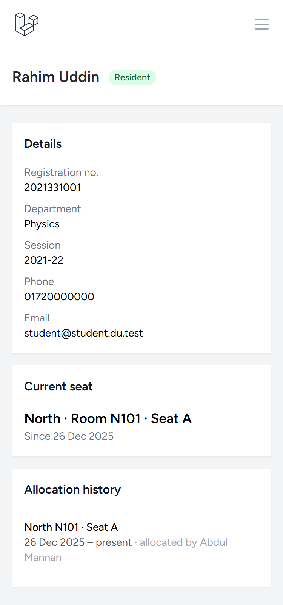
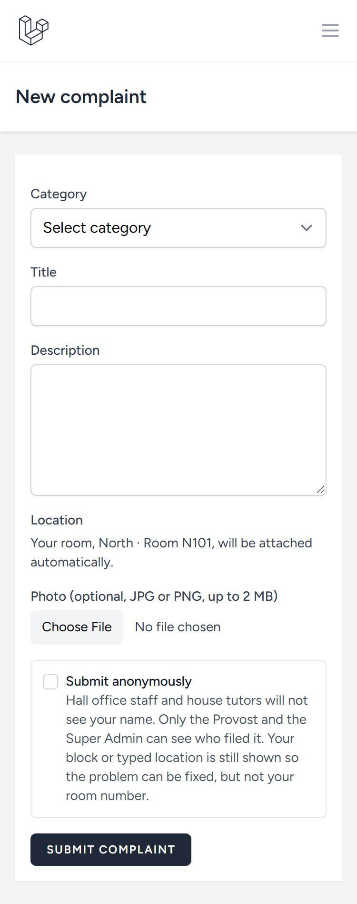
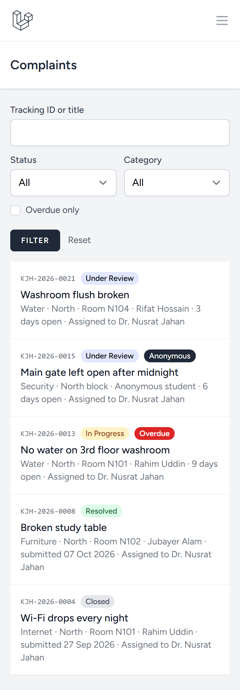

# Visual / UI Design Check

Checked on 22 Oct 2026 against the design requirements in `docs/ASSESSMENT.md` (§9.1 Track A UI, §12 rubric "UI / UX", §13 self-check) and `docs/CLAUDE.md`.

**Method:** Chrome (Claude in Chrome) against a local `php artisan serve` with the seeded demo data. Each page was loaded in a 375 px wide frame and checked for sideways scrolling (`scrollWidth > clientWidth`) and for form controls with no label. Key screens were also inspected visually.

## Requirements

| Source | Requirement |
|---|---|
| §9.1 UI | Blade with Tailwind, mobile-friendly, shows validation errors and success messages |
| §12 UI / UX (10%) | Clear, responsive, consistent; good loading, empty and error states; helpful validation messages |
| §13 self-check | The interface works on a 375 px wide screen |
| `docs/CLAUDE.md` | Breeze (Blade + Tailwind), mobile-friendly at 375 px |

## Summary

| Requirement | Result | Notes |
|---|:---:|---|
| Works at 375 px | ✅ | No sideways scrolling on any page checked, across 3 roles |
| Validation errors | ✅ | Summary box plus a message under each field |
| Success messages | ✅ | One `status` flash key, shown in a green box by both layouts |
| Empty states | ✅ | Clear "nothing found" text on filtered lists |
| Labels on inputs | ✅ | No unlabelled input, select or textarea found |
| Consistent styling | ✅ | Mobile menu, filters and cards look the same across pages |
| Error states (403 / 404) | ✅ | Fixed: app-styled pages with a way back (see Issue 1) |

## 375 px results by role

Sideways overflow in pixels (0 = fits). "403" means the role is correctly refused.

| Page | Office Staff | Student | House Tutor |
|---|:---:|:---:|:---:|
| `/dashboard` | 0 | 0 | 0 |
| `/notices` | 0 | 0 | 0 |
| `/notices/{id}` | 0 | – | – |
| `/clubs` | 0 | 0 | 0 |
| `/clubs/{id}` | 0 | 0 | 0 |
| `/complaints` | 0 | 0 | 0 |
| `/complaints/create` | 403 | 0 | 403 |
| `/complaints/{tracking id}` | 0 | 0 | 0 |
| `/students` | 0 | 403 | 0 |
| `/students/{id}` | 0 | – | 0 |
| `/rooms` | 0 | 403 | 403 |
| `/rooms/{id}` | 0 | – | – |
| `/rooms/create` | 0 | – | – |
| `/blocks` | 0 | – | – |
| `/blocks/create` | 0 | – | – |
| `/registrations` | 0 | 403 | 403 |
| `/admin/notices` | 0 | 403 | 403 |
| `/admin/notices/create` | 0 | 403 | 403 |
| `/profile` | 0 | 0 | 0 |

## What was seen

**Validation.** Submitting New Complaint empty shows "Please fix the highlighted fields." at the top and a red message under each field ("The category field is required.", "The title field is required.", "The description field is required."). New Block behaves the same way.

**Empty states.**

| Page | Message |
|---|---|
| Complaints, search matches nothing | "No complaints found." |
| Students, search matches nothing | "0 students — No students match these filters." |
| Notices, page past the end | "No notices found." |

**Mobile layout.** At 375 px the top menu collapses into a menu button, the complaint filters stack into two columns, and list rows wrap their metadata instead of overflowing. The notice manager keeps its "New notice" button in the header and its All / Published / Drafts filter buttons on one line.

Existing 375 px screenshots:

| Student profile | Submit complaint | Tutor's complaints |
|---|---|---|
|  |  |  |

## Issues found

### 1. Default error pages — ✅ fixed

There is no `resources/views/errors/` folder, so a refused request shows Laravel's plain dark page: **"403 | THIS ACTION IS UNAUTHORIZED."** It has no app menu, no explanation and no way back. The scoring rubric asks for good error states, so this is the one item that costs points.

**Fix:** add `errors/403.blade.php` and `errors/404.blade.php` using the app layout, with a short message and a "Back to dashboard" link.

**Done:** `errors/403.blade.php` ("Access denied") and `errors/404.blade.php` ("Page not found") share `errors/partials/page.blade.php`, which uses the public layout. Its menu works for both guests and signed-in users, and it renders even when no route matched. Signed-in users get "Back to dashboard"; guests get "Go to the notice board" and "Log in". Checked at 375 px with no overflow. Writing the 404 test exposed a crash in the public layout (`$errors` is not shared when no route matches); that check is now guarded. Covered by `tests/Feature/ErrorPagesTest.php`.

### 2. Generic tab titles — ✅ fixed

Most signed-in pages have the tab title "KJH Hall". Only the public pages add the page name ("Notices · KJH Hall", "Cultural Club · KJH Hall"). That makes several open tabs hard to tell apart.

**Done:** `AppLayout` and `GuestLayout` now take an optional `title`, shown as "Page · KJH Hall", the same as the public layout. Every app and auth page sets one (for example "Complaints", "KJH-2026-0023", "Room N101", "Log in").

### 3. Small tap targets on the notice manager (minor)

On `/admin/notices`, the View / Edit / Delete links on each row are about 20 px tall. That's fine with a mouse but small for a thumb. Common guidance is at least 24 px, and 44 px is better.

### 4. Two different flash patterns (minor)

The app uses free-text `status` messages everywhere except two Breeze profile forms, which match fixed values (`profile-updated`, `password-updated`). It works, but it's a different pattern from the rest of the app.

## Not checked

- Colour contrast was not measured with a tool. Visually, text on badges and buttons reads clearly.
- Keyboard focus order and visible focus rings were not tested.
- Super Admin, Provost and Club Admin were not covered by the 375 px audit. The earlier check in `PROGRESS.md` covered all six roles.
